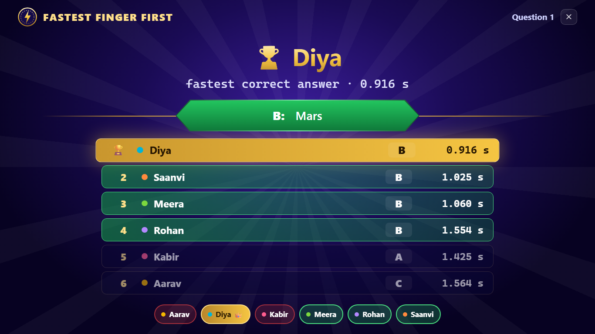
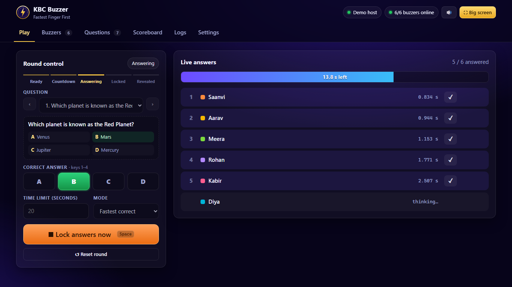
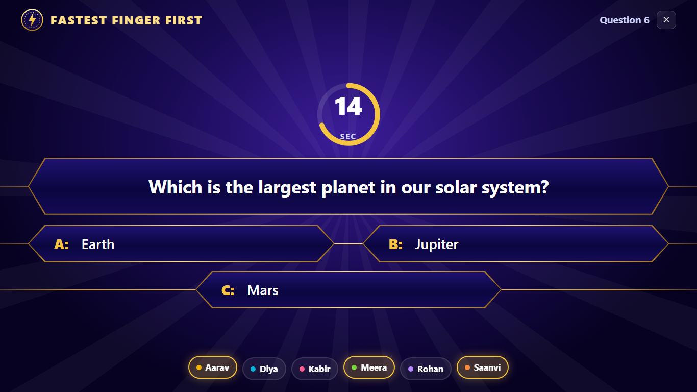
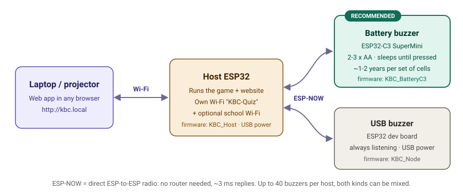
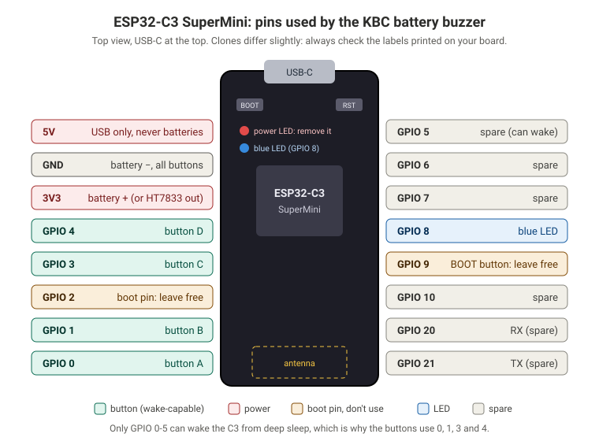
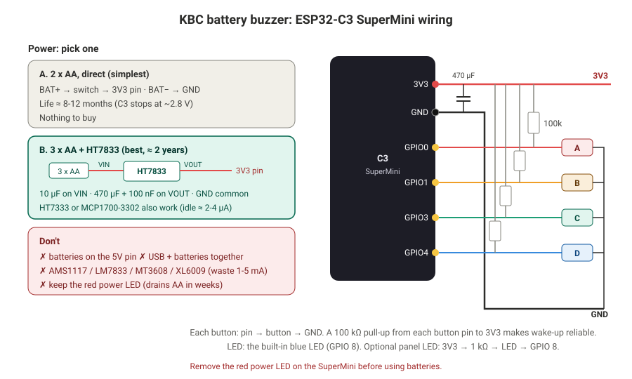
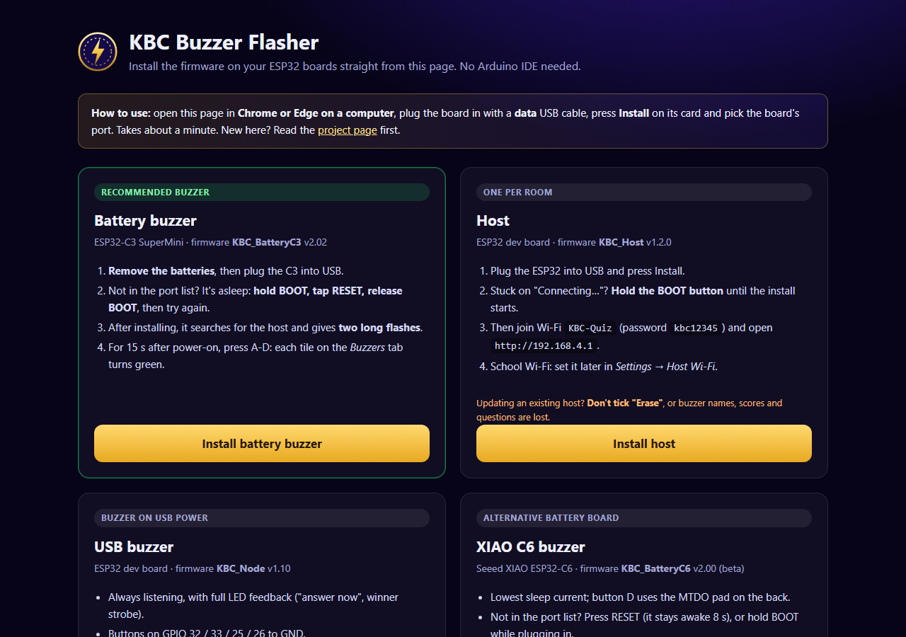

# KBC Buzzer: Fastest Finger First for the classroom

A wireless quiz-buzzer system inspired by the **"Fastest Finger First"** round of
*Kaun Banega Crorepati*. The teacher runs the quiz from a laptop or projector. Every student
holds a small battery buzzer with four buttons, **A B C D**. The **fastest correct answer wins**,
timed to the millisecond.



- **Buzzer:** an **ESP32-C3 SuperMini** on 2-3 AA cells. It sleeps between presses, so one set of cells lasts about **1-2 years** (estimate).
- **Host:** one ESP32 that runs the game and serves the website. No internet or router needed.
- **Radio:** ESP-NOW, direct ESP-to-ESP. A press reaches the host in about 90 ms, and the host answers in 3-5 ms.

## What you get

| Teacher console | Big screen on the projector |
|---|---|
|  |  |

- **KBC-style big screen:** countdown, question, 2-4 options, timer ring, ranked results, confetti. Works on phones too.
- **One-key control:** **Space** steps through a round (start → lock → reveal → next).
- **Fair timing,** even for buzzers that were asleep when the question opened ([how](docs/HOW_IT_WORKS.md#4-fair-timing)).
- **Zero setup per buzzer:** every buzzer runs the same firmware and pairs itself; you just name it.
- **Question bank** (2, 3 or 4 options), paste-many, JSON import/export, scoreboard, CSV history.
- **Built-in diagnostics:** a live button test for every buzzer, plus a **Logs** tab showing every device's messages, no USB cable needed.
- **Everything configurable** from the browser: rules, points, timing, Wi-Fi, titles, sounds.

## How it fits together



| Part | Board | Firmware |
|---|---|---|
| **Buzzer (recommended)** | ESP32-C3 SuperMini + 4 buttons + 2-3 AA | [`KBC_BatteryC3`](KBC_BatteryC3) |
| Buzzer, USB powered | any ESP32 dev board + 4 buttons | [`KBC_Node`](KBC_Node) |
| Buzzer, alternative battery board | Seeed XIAO ESP32-C6 | [`KBC_BatteryC6`](KBC_BatteryC6) |
| **Host** (one per room) | any ESP32 dev board, USB powered | [`KBC_Host`](KBC_Host) |

All buzzer types can be mixed in one game, up to **40 per host**.

## The buzzer: ESP32-C3 SuperMini

| Pinout | Wiring |
|---|---|
|  |  |

Buttons on **GPIO 0 / 1 / 3 / 4** (A-D) to GND, a 100 kΩ pull-up on each, the built-in blue LED
for feedback, and 2 AA straight to **3V3** (or 3 AA through an HT7833). **Remove the red power LED.**
Full details, PCB layout and parts list: **[Hardware guide](docs/HARDWARE.md)**.

## Install from your browser

**[Open the KBC Buzzer Flasher](https://shubhjaiswal408.github.io/kbc-fastest-finger-first/flasher/)**: plug a board into USB, press *Install* on its card,
pick the port. Works in Chrome or Edge on a computer. No Arduino IDE needed.

[](https://shubhjaiswal408.github.io/kbc-fastest-finger-first/flasher/)

## Quick start

1. **Build the buzzers** as shown above ([hardware guide](docs/HARDWARE.md)).
2. **Flash the firmware** with the **[web flasher](https://shubhjaiswal408.github.io/kbc-fastest-finger-first/flasher/)**, or with the Arduino IDE (esp32 core 3.x, no extra libraries):
   - every buzzer: `KBC_BatteryC3` (*ESP32C3 Dev Module*, USB CDC On Boot: Enabled, Flash Mode: DIO)
   - one host: `KBC_Host` (*ESP32 Dev Module*)
3. **Power the host** and join its Wi-Fi **KBC-Quiz** (password `kbc12345`). Open **http://192.168.4.1** or **http://kbc.local**.
4. **Switch on each buzzer.** It appears on the *Buzzers* tab within seconds. For 15 s after power-on, press A-D: each tile turns green if its wire works.
5. Press **Big screen**, then **Space** to start a round.

Step-by-step with screenshots: **[User guide](docs/USER_GUIDE.md)**. Want the "why"? **[How it works](docs/HOW_IT_WORKS.md)**.

No hardware yet? Open `web/index.html` in a browser (or add `?demo` to the URL): it runs with simulated buzzers.

## Documentation

| Guide | For |
|---|---|
| [User guide](docs/USER_GUIDE.md) | Running a quiz: pairing, questions, rounds, scores, settings, LED meanings |
| [How it works](docs/HOW_IT_WORKS.md) | The ideas behind it: radio, pairing, fair timing, sleeping buzzers, channels |
| [Hardware guide](docs/HARDWARE.md) | Building: parts, pinout, wiring, power options, PCB layout, flashing, troubleshooting |

## Repository layout

```
KBC_BatteryC3/     buzzer firmware, ESP32-C3 SuperMini (recommended)
KBC_Node/          buzzer firmware, ESP32 dev board on USB
KBC_BatteryC6/     buzzer firmware, Seeed XIAO ESP32-C6 (alternative)
KBC_Host/          host firmware: game, radio, web server, embedded web app
web/index.html     the web app source (one file, works offline)
tools/embed.ps1    packs web/index.html into KBC_Host/web_index.h (gzip)
docs/              guides and images
docs/flasher/      the web flasher (GitHub Pages) with ready-built firmware
```

## Project status

| Part | Status |
|---|---|
| Host + USB buzzers | Tested on real hardware: pairing, rounds, winners, button test, logs |
| C3 SuperMini buzzer | Tested on real hardware: pairing, wake on all 4 buttons, ~90 ms press-to-send, LED feedback. Battery life not measured yet. |
| XIAO C6 buzzer | Builds and pairs; press path not fully tested |
| Web app | Tested in Chrome/Edge at laptop and phone sizes |

## License

[MIT](LICENSE): free to use, modify and share, including in your own projects.
