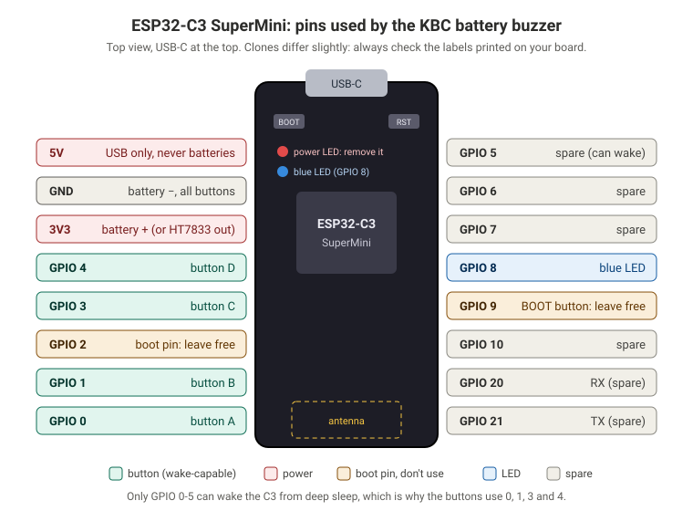
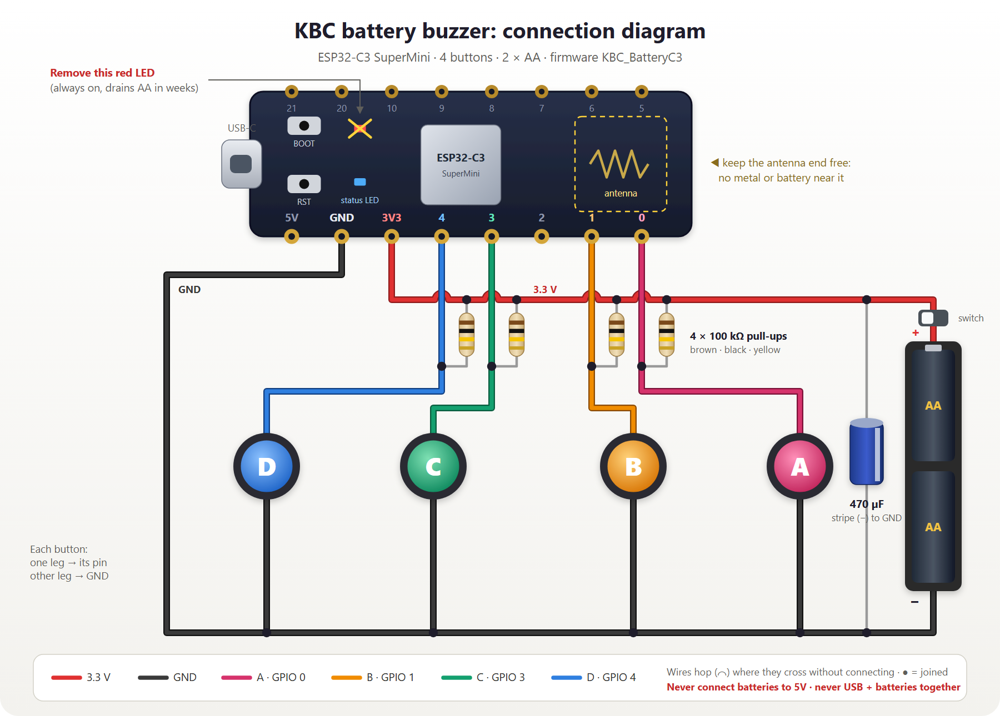
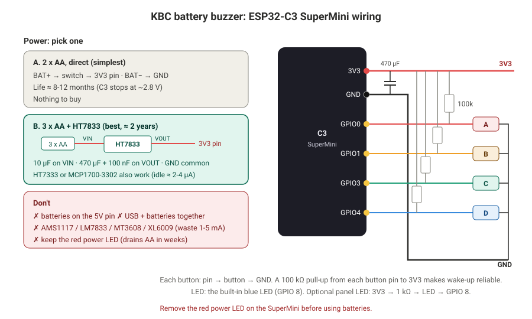
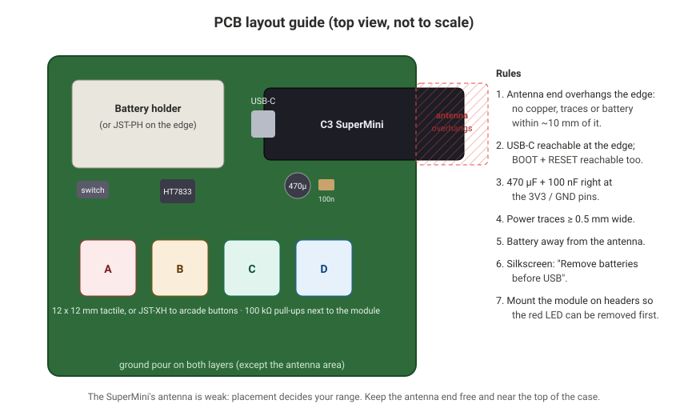
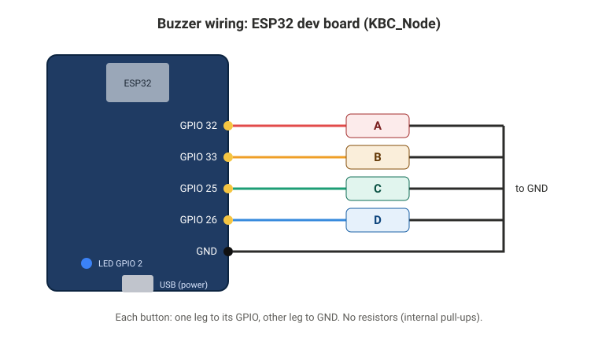
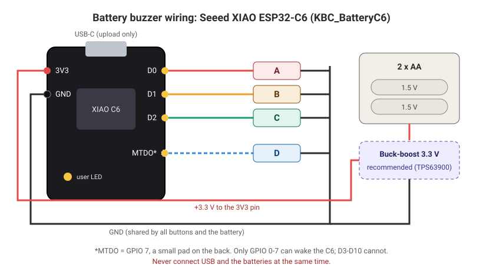

# Hardware guide

The recommended buzzer is the **ESP32-C3 SuperMini** on AA cells. This guide covers building it,
the host, and the other buzzer options.

- [Parts](#parts)
- [ESP32-C3 SuperMini buzzer](#esp32-c3-supermini-buzzer)
  - [Pinout](#pinout)
  - [Wiring](#wiring)
  - [Power options](#power-options)
  - [PCB design](#pcb-design)
- [Host](#host)
- [Other buzzer options](#other-buzzer-options)
- [Flashing the firmware](#flashing-the-firmware)
- [Troubleshooting](#troubleshooting)

## Parts

**Per buzzer (C3 SuperMini):**

| Part | Notes |
|---|---|
| ESP32-C3 SuperMini | the buzzer brain (built-in USB-C, blue LED, BOOT + RESET buttons) |
| 4 push buttons | 12 × 12 mm tactile, or arcade buttons on JST-XH cables |
| 4 × 100 kΩ resistors | pull-ups, for reliable wake-up from sleep |
| 470 µF capacitor (6.3 V+, low ESR) + 100 nF | across 3V3 and GND, for the radio's current bursts |
| AA holder: **2 × AA**, or **3 × AA + HT7833** | see [power options](#power-options) |
| Slide switch (optional) | turns the buzzer fully off |
| 5 mm LED + 1 kΩ (optional) | a bigger LED for the case |

**Once:** one ESP32 dev board (ESP32-WROOM, "ESP32 Dev Module") as the host, plus a USB charger.

Where to buy in India: Robu.in, Robocraze, ElectronicsComp and Amazon.in; local electronics markets
(e.g. Relief Road, Ahmedabad) usually stock HT73xx regulators and capacitors.

## ESP32-C3 SuperMini buzzer

### Pinout



| Pin | Use | Why |
|---|---|---|
| **GPIO 0** | button **A** | only GPIO 0-5 can wake the C3 from deep sleep |
| **GPIO 1** | button **B** | |
| **GPIO 3** | button **C** | |
| **GPIO 4** | button **D** | |
| GPIO 2, 8, 9 | not used for buttons | boot (strapping) pins: a pressed button at power-up would stop it starting |
| **GPIO 8** | blue LED (built in) | lights when LOW |
| **3V3** | battery + (or regulator output) | |
| **GND** | battery −, all buttons | |
| 5V | **nothing** | USB only; batteries here won't work |

### Wiring



The same circuit as a schematic, with both power options:



1. Each button: **pin → button → GND.**
2. A **100 kΩ resistor from each button pin to 3V3.** Espressif recommends external pull-ups
   when waking from a LOW pin; they draw current only while a button is held.
3. **470 µF + 100 nF across 3V3 and GND**, close to the board.
4. **Remove the red power LED** on the SuperMini (desolder it, or cut its trace). It's always on
   and drains AA cells in weeks.

> **4-leg tactile buttons:** the two legs on the same side are always connected inside.
> Use two **diagonally opposite** legs.

### Power options

| Option | Circuit | Estimated life* |
|---|---|---|
| **A. 2 × AA, direct** | BAT+ → switch → **3V3**, BAT− → GND | about 8-12 months |
| **B. 3 × AA + HT7833** (best) | BAT+ → switch → HT7833 VIN; VOUT → **3V3**; 10 µF on VIN, 470 µF + 100 nF on VOUT | about 2 years |
| C. 2 × AA + boost module | only a module whose **no-load current you measured below 20 µA** | depends on the module |

*About 100 presses a day, red LED removed. Estimates, not measurements.

**Avoid** AMS1117, LM7833 (need more than 4.4 V and waste about 5 mA), MT3608 and XL6009 (waste about 1 mA when idle).
HT7333 and MCP1700-3302 also work in option B (250 mA, about 2-4 µA idle). Check the regulator's
**pin order** for your package in its datasheet before soldering.

**Never connect USB and batteries at the same time.** Remove the cells before uploading.

### PCB design



**Netlist**

| Net | Connects |
|---|---|
| VBAT | battery + → switch → U1 VIN (option B) or straight to 3V3 (option A) |
| 3V3 | U1 VOUT · module 3V3 · C2 470 µF + · C3 100 nF · R1-R4 · (R5 for panel LED) |
| GND | battery − · module GND · U1 GND · C1 · C2 · C3 · all buttons |
| BTN_A | module GPIO 0 · R1 100 kΩ to 3V3 · button A to GND |
| BTN_B | module GPIO 1 · R2 100 kΩ to 3V3 · button B to GND |
| BTN_C | module GPIO 3 · R3 100 kΩ to 3V3 · button C to GND |
| BTN_D | module GPIO 4 · R4 100 kΩ to 3V3 · button D to GND |
| LED (optional) | 3V3 → R5 1 kΩ → LED → module GPIO 8 |
| 5V, GPIO 2, GPIO 9 | not connected |

**Layout rules**

1. **The antenna end of the SuperMini (opposite USB-C) overhangs the PCB edge,** with no copper,
   traces or battery within about 10 mm. The SuperMini's antenna is weak, so this decides your range.
2. USB-C, **BOOT** and **RESET** reachable from outside the case.
3. 470 µF and 100 nF right at the module's 3V3/GND pins; power traces at least 0.5 mm wide.
4. Ground pour on both layers, except under the antenna.
5. Mount the module on female headers, so it can be swapped and its red LED removed first.
6. Silkscreen: *"Remove batteries before connecting USB."*
7. Module footprint: 2 × 8 pins, 2.54 mm pitch. **Measure the row spacing on your board**, since clones differ.

## Host

Any ESP32 dev board on USB power runs `KBC_Host`. No wiring is needed. Put it high up, in the
middle of the room, away from metal.

**Optional: let the host join your Wi-Fi.** Copy `KBC_Host/wifi_secrets.example.h` to
`KBC_Host/wifi_secrets.h` and fill in your network. You can then open **http://kbc.local** from any
laptop on that network. `wifi_secrets.h` is git-ignored, so the password never gets committed. You
can also set this later in *Settings → Host Wi-Fi*.

## Other buzzer options

**USB buzzer, ESP32 dev board (`KBC_Node`):** always listening, so it has full LED feedback ("answer now"
blinking, winner strobe), but it needs USB power.



| Button | Pin |
|---|---|
| A / B / C / D | GPIO 32 / 33 / 25 / 26 → GND (internal pull-ups, no resistors needed) |
| LED | on-board LED, GPIO 2 |

**Seeed XIAO ESP32-C6 (`KBC_BatteryC6`):** lower sleep current (about 15 µA) and a built-in antenna; button D uses
the MTDO pad on the back.



## Flashing the firmware

**Easiest: the [web flasher](https://shubhjaiswal408.github.io/kbc-fastest-finger-first/flasher/).** Open it in Chrome or Edge on a computer, plug the board in,
press *Install* on its card. It installs ready-built firmware for the two boards you need: the
**C3 SuperMini buzzer** and the **host**. (The public host firmware has no Wi-Fi password built in;
set your school Wi-Fi in the host's *Settings*.) The USB and XIAO C6 buzzers are built from source
(table below).

**Or build it yourself** with Arduino IDE 2 and **esp32 by Espressif** version **3.x**. No extra libraries.

| Sketch | Board | Options |
|---|---|---|
| `KBC_BatteryC3` | ESP32C3 Dev Module | USB CDC On Boot: **Enabled** · Flash Mode: **DIO** |
| `KBC_Host` | ESP32 Dev Module | defaults |
| `KBC_Node` | ESP32 Dev Module | defaults |
| `KBC_BatteryC6` | XIAO_ESP32C6 | USB CDC On Boot: Enabled |

With arduino-cli:

```bash
arduino-cli compile --fqbn esp32:esp32:esp32c3:CDCOnBoot=cdc,FlashMode=dio KBC_BatteryC3
```

```bash
arduino-cli upload  --fqbn esp32:esp32:esp32c3:CDCOnBoot=cdc,FlashMode=dio -p COM26 KBC_BatteryC3
```

**Uploading to a sleeping C3:** its USB port disappears while it sleeps. **Hold BOOT, tap RESET,
release BOOT.** That keeps it in upload mode until the upload finishes.

**Host upload fails with "Wrong boot mode detected"?** Some ESP32 boards can't enter upload mode
by themselves. Hold **BOOT** while the upload starts.

After changing `web/index.html`, rebuild the embedded page and re-flash the host:

```bash
powershell -ExecutionPolicy Bypass -File tools/embed.ps1
```

## Troubleshooting

| Problem | Cause / fix |
|---|---|
| C3 never reaches the host ("host not found") | SuperMini antenna fault: the firmware already lowers transmit power to 8.5 dBm. Keep the antenna end free; move closer. |
| Buttons don't wake the C3 | Add the 100 kΩ pull-ups. Check that the pin goes to GND when pressed (use diagonal legs of 4-leg buttons). |
| Blue LED: 5 fast flashes after a press | Host not found: is the host on and in range? |
| Startup log says **BROWNOUT** | Cells too weak, or the 470 µF capacitor is missing |
| A button "presses itself" | Loose wire: the button test shows "loose contact" |
| Battery buzzer shows "asleep" when it's off | Normal: the host only knows after a missed hourly check-in |
| Upload fails on the C3 | Hold BOOT, tap RESET, release BOOT, then upload |
| Web page slow / "host did not answer" | Move closer to the host; reload the page |
