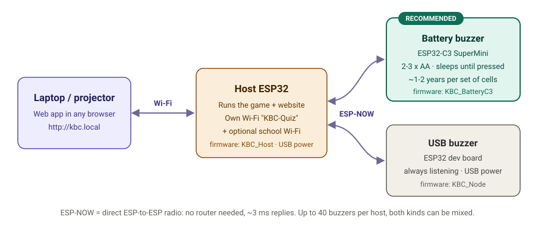
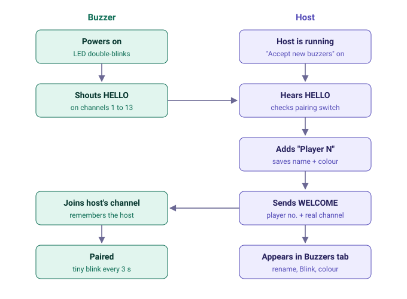
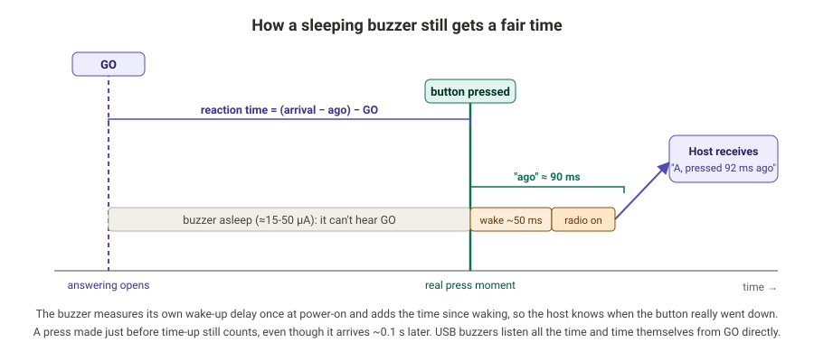

# How it works

This page explains the ideas behind KBC Buzzer: what each part does, why it's designed this way,
and what happens between a student pressing a button and the winner appearing on the screen.

- [1. The big picture](#1-the-big-picture)
- [2. The radio: ESP-NOW](#2-the-radio-esp-now)
- [3. Pairing: how a new buzzer joins](#3-pairing-how-a-new-buzzer-joins)
- [4. Fair timing](#4-fair-timing)
- [5. Why the buzzer sleeps, and how long the batteries last](#5-why-the-buzzer-sleeps-and-how-long-the-batteries-last)
- [6. A round, step by step](#6-a-round-step-by-step)
- [7. Wi-Fi channels](#7-wi-fi-channels)
- [8. The host's web server](#8-the-hosts-web-server)
- [9. Diagnostics: button test and logs](#9-diagnostics-button-test-and-logs)
- [10. Limits](#10-limits)

---

## 1. The big picture

There are three kinds of device:

| Device | Job |
|---|---|
| **Host** (one ESP32 on USB power) | Runs the game rules, keeps scores, talks to every buzzer by radio, and serves the website |
| **Buzzers** (one per student) | Report button presses. The recommended one is an ESP32-C3 SuperMini on AA cells. |
| **Laptop / projector / phone** | Just a web browser showing the host's website. Nothing to install. |

The host creates its own Wi-Fi network (`KBC-Quiz`), so the whole system works in a classroom
without internet. It can *also* join the school Wi-Fi so the teacher's laptop can stay on it.

## 2. The radio: ESP-NOW

Buzzers don't use normal Wi-Fi. They use **ESP-NOW**, an Espressif radio protocol that sends
small packets **directly from one ESP32 to another**, with no router, no connection setup and no IP
addresses. That gives:

- **speed:** a reply comes back in about 3-5 ms;
- **simplicity:** a buzzer just switches its radio on and talks;
- **low power:** a battery buzzer only needs its radio for a fraction of a second per press.

The host **broadcasts** to everyone at once (round state, replies, welcomes), and each buzzer
picks out the messages addressed to it. That's why there's no small "peer limit" on the number of buzzers.

## 3. Pairing: how a new buzzer joins

1. A new buzzer doesn't know which Wi-Fi channel the host is on, so it **shouts HELLO on every channel**, 1 to 13.
2. The host hears it. If **Accept new buzzers** is on, it adds the buzzer as "Player N" and saves it.
3. The host replies **WELCOME**, including its **real channel**.
4. The buzzer moves to that channel and **remembers the host**. Next time it reconnects in under a second.

Wi-Fi channels overlap, so a buzzer can sometimes faintly hear the host on a neighbouring channel. That's
why it always moves to the channel the host *tells* it, rather than the one it happened to hear.

## 4. Fair timing

The winner is decided by **reaction time**: from the moment answering opens ("GO") until the
button went down. Radio delay must not change the result.

**USB buzzers** listen all the time. They note when they heard GO and time the press themselves,
capturing the button in a hardware interrupt to the microsecond.

**Battery buzzers** are asleep when GO happens, so they can't hear it. Instead:

1. The button press itself **wakes the chip**.
2. On its first power-up, the buzzer **measures its own wake-up delay** (about 50 ms on a C3).
3. When it sends the answer, it adds **"I was pressed X ms ago"**: wake-up delay + time since waking.
4. The host works out the real press moment: **arrival time − X**.

So the host compares everyone on the same clock. A press made just before time runs out still
counts, even though its packet arrives about 0.1 s later. The host also never accepts a time
"faster than physically possible" for what it actually saw.

## 5. Why the buzzer sleeps, and how long the batteries last

An ESP32 with its radio listening draws about **80-100 mA**. 2 AA cells (about 2,500 mAh) would
last roughly **one day**. So the battery buzzer is built around **deep sleep**:

| State | Current (C3 SuperMini, red LED removed) | How long |
|---|---|---|
| Deep sleep | ≈ 40-60 µA | almost all the time |
| Awake after a press | ≈ 80 mA | ~0.5 s per press |
| Hourly check-in | ≈ 80 mA | ~0.35 s once an hour |

With about 100 presses a day, that adds up to roughly **0.8-1 Ah per year**. Estimated life:

| Power | Estimate |
|---|---|
| 2 × AA straight to 3V3 | about 8-12 months (the C3 stops at ~2.8 V, so part of the cell is unused) |
| 3 × AA through an HT7833 regulator | about 2 years |
| Red power LED left on | about 1-2 months (that LED alone draws more than everything else) |

These are estimates; measure your own board with a multimeter in series with the battery.

**The trade-off:** a sleeping buzzer gives LED feedback **only right after a press** (accepted,
already answered, false start, …). It can't blink "answer now", because it's asleep while it waits.
The big screen shows who won.

**"Online" vs "asleep":** the host can't tell a sleeping buzzer from one that's switched off until it
misses its hourly check-in. So battery buzzers show as **amber "🔋 asleep · last heard …"**.

## 6. A round, step by step

| Phase | Host | Buzzers | Big screen |
|---|---|---|---|
| **Ready** | waiting | asleep / listening | logo and player names |
| **Countdown** (3-2-1) | tells everyone a round is starting | a press now = **false start** | big countdown |
| **Answering** | starts the clock (GO), heartbeat every 150 ms | a press sends the answer + its timing | question, options, timer ring |
| **Locked** | time's up, or everyone answered, or the teacher pressed Space | late presses are refused | "answers locked" |
| **Revealed** | picks the fastest correct answer, adds points | winner info sent out | green correct option, ranked times, confetti |

The question's correct answer stays on the host until **Reveal**, so it never reaches the big screen early.

## 7. Wi-Fi channels

The host's own network and ESP-NOW share **one radio, so one channel**. If the host also joins
the school Wi-Fi, it must use **that router's channel**. When the router changes channel (common
with auto-channel routers), the host follows, and the buzzers find it again by themselves.

## 8. The host's web server

The ESP32's built-in web server handles one browser connection at a time. It **waits up to
5 seconds** for a connection that says nothing, and it waits while a slow phone reads its reply.
KBC Buzzer uses its own small server instead (`KBC_Host/mini_web.h`):

- it keeps 8 connections open side by side, and drops silent ones;
- it **reuses connections** (keep-alive), so the page's 200 ms polling doesn't open a new
  connection every time;
- it **never waits on a client**: each reply is queued and sent bit by bit, so one slow phone
  can't hold up the others.

**Both CPU cores are used:**

| Core | Runs |
|---|---|
| Core 0 | Wi-Fi stack + the web server |
| Core 1 | Game and radio (high priority, alone), woken the moment a packet arrives |

Saving to flash pauses both cores for a moment, so player and score saves wait about 1.5 s and
never happen in the middle of a press.

**Grace after the lock:** the host waits 0.3 s between *lock* and *reveal*. A press made just
before the lock, still in the air, is counted for both battery and USB buzzers.

The whole web app is one HTML file, **gzip-compressed** inside the firmware (about 28 KB). It
loads in well under a second.

## 9. Diagnostics: button test and logs

- **Button test** (*Buzzers* tab): every buzzer reports its button presses. Tiles turn gold
  while held and green once they've worked. On a battery buzzer, for 15 s after power-on, every
  press is reported instantly (wiring check).
- **Logs** tab: the host and every buzzer send their log lines over the radio, so you can see
  what each device is doing without a USB cable. Battery buzzers report their **reset reason**
  (e.g. *BROWNOUT* = weak cells or missing capacitor) and **pin levels** at power-on.

## 10. Limits

| Limit | Value |
|---|---|
| Buzzers per host | 40 (a firmware setting; the radio could handle more) |
| Range, C3 SuperMini | about 10-20 m indoors (its antenna is small; keep the antenna end free) |
| Range, ESP32 dev board | about 30-50 m indoors |
| Rooms | one host per room. After pairing, turn **Accept new buzzers** off so buzzers don't join the wrong room. |
