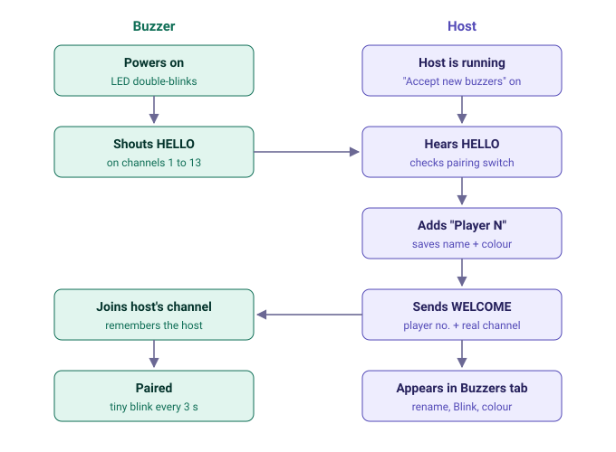
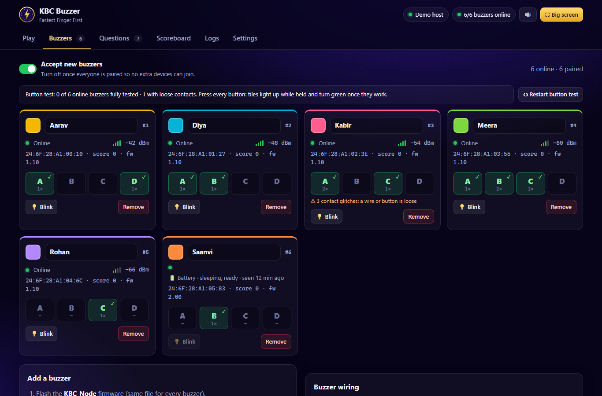
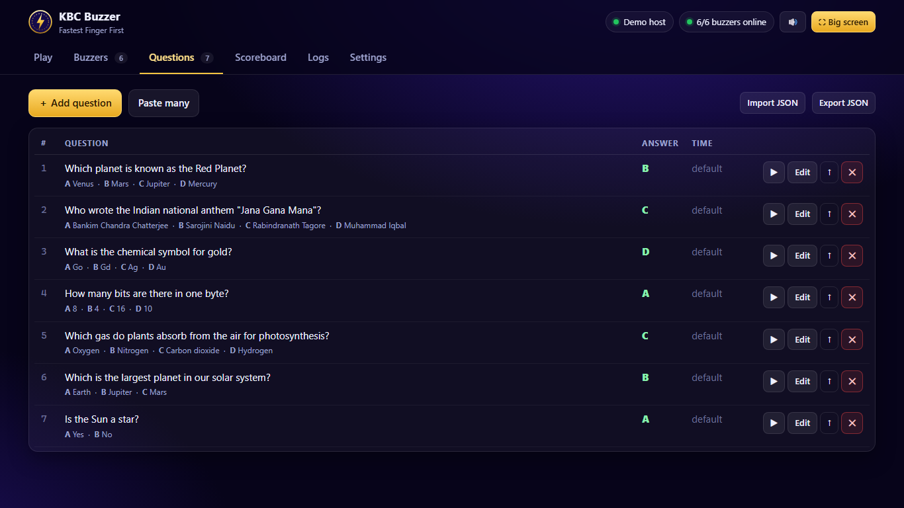
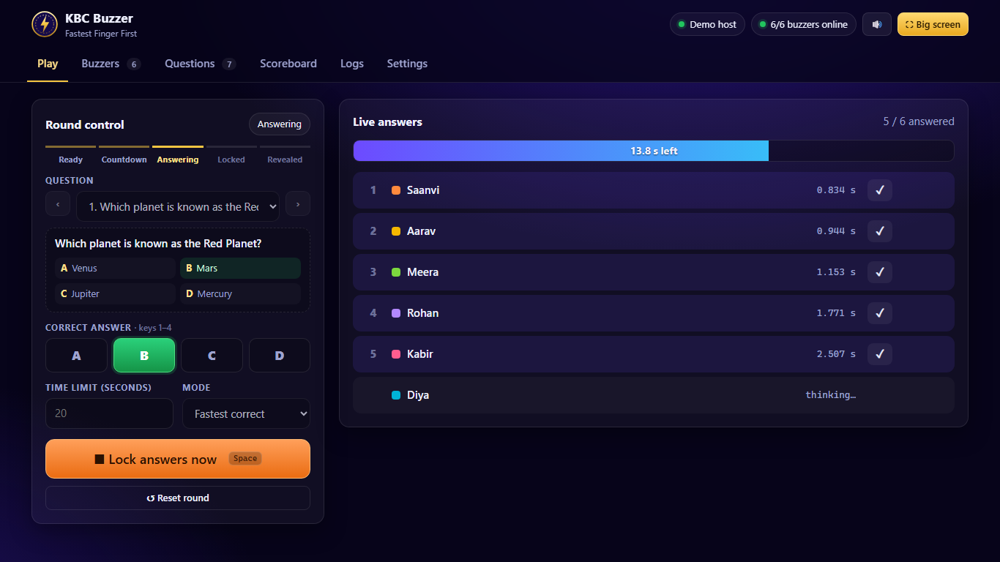
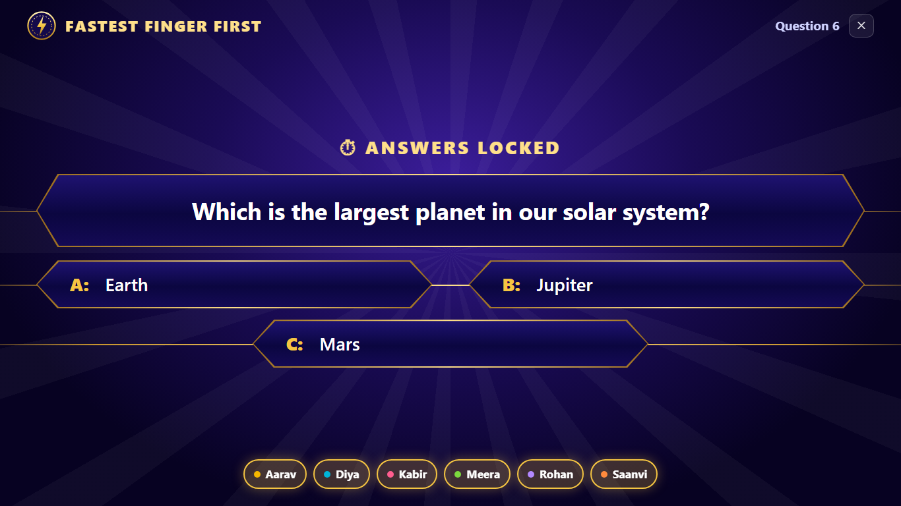
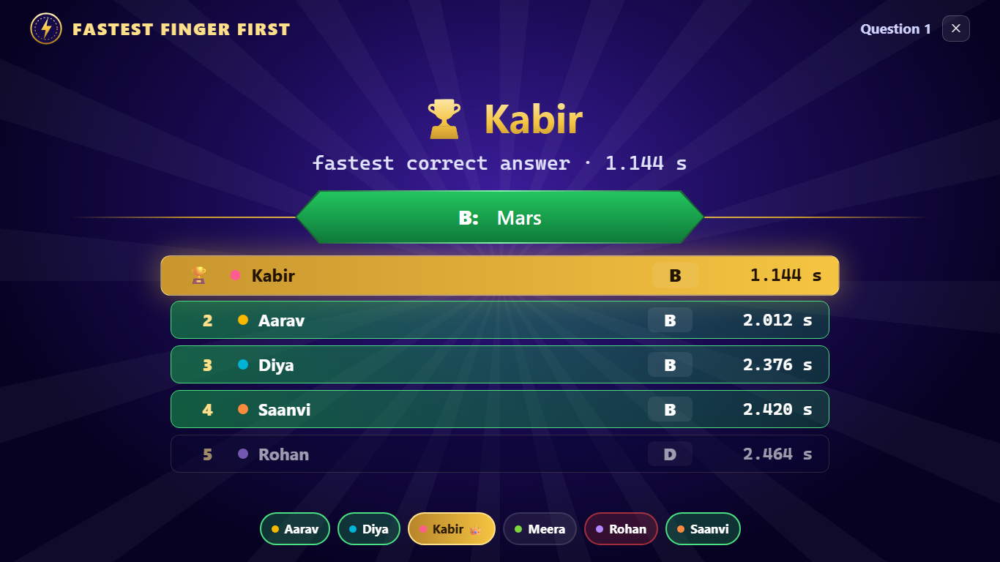
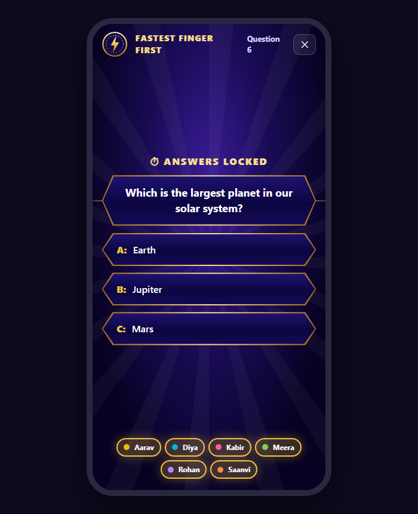
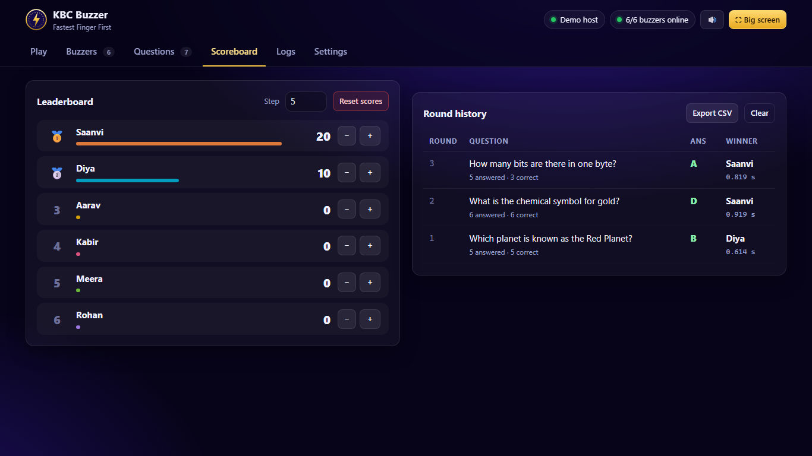
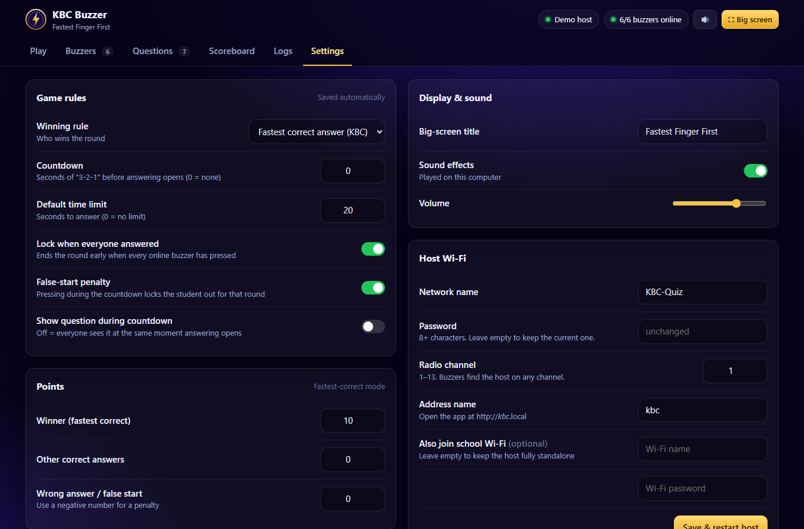
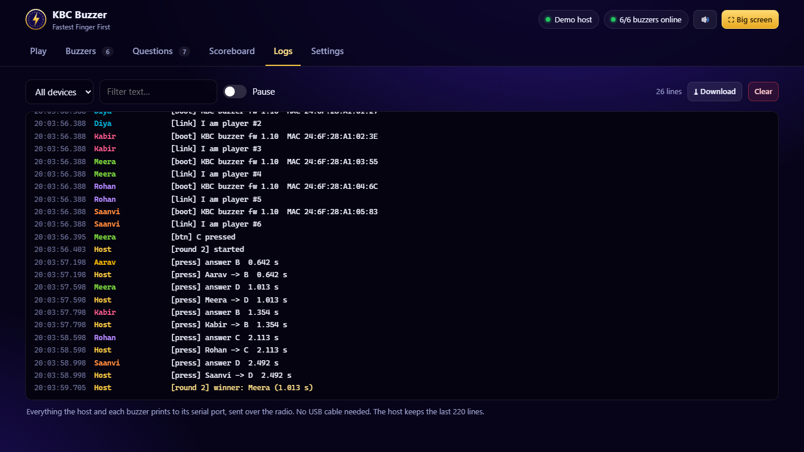

# User guide

This guide is for the person running the quiz. No programming needed.

- [1. Before class](#1-before-class)
- [2. Connect to the host](#2-connect-to-the-host)
- [3. Pair the buzzers](#3-pair-the-buzzers)
- [4. Test every button](#4-test-every-button)
- [5. Add questions](#5-add-questions)
- [6. Run a round](#6-run-a-round)
- [7. Scores and history](#7-scores-and-history)
- [8. Settings](#8-settings)
- [9. Logs: when something goes wrong](#9-logs-when-something-goes-wrong)
- [Buzzer LED meanings](#buzzer-led-meanings)
- [Keyboard shortcuts](#keyboard-shortcuts)
- [FAQ](#faq)

---

## 1. Before class

You need:
- the **host** (one ESP32, USB powered, e.g. from a phone charger),
- one **buzzer** per student or team,
- a laptop or tablet, plus a projector for the big screen if you have one.

## 2. Connect to the host

The host creates its own Wi-Fi network:

| | |
|---|---|
| Wi-Fi name | `KBC-Quiz` |
| Password | `kbc12345` |
| Address | **http://192.168.4.1** or **http://kbc.local** |

Join the Wi-Fi and open the address. If your phone says "no internet", choose **stay connected**.

> **Tip:** the host can also join your school Wi-Fi (*Settings → Host Wi-Fi*). Then your laptop
> stays on the normal Wi-Fi and you just open **http://kbc.local**.

## 3. Pair the buzzers

Switch a buzzer on near the host. It finds the host by itself in about a second.
There is no button or code to type.



On the **Buzzers** tab each buzzer gets a card:



- **Rename** it: click the name and type the student's name.
- **Colour:** click the colour square.
- **Blink:** flashes that buzzer's LED so you can tell which physical buzzer is which.
- **Remove:** deletes it. It re-joins as a new player if *Accept new buzzers* is on.
- Turn **Accept new buzzers** off once everyone is paired, so no extra devices can join.

A paired buzzer remembers the host. Next time it reconnects in under a second, even if the host
moved to another Wi-Fi channel.

## 4. Test every button

Still on the **Buzzers** tab, ask every student to press **A, B, C and D**.

- A tile turns **gold** while the button is held and **green ✓** once it has worked.
- An orange **"loose contact"** warning means a wire is flickering. Push it in firmly.
- When every button on every buzzer works, the summary at the top turns green.
- **Restart button test** clears the counts.

## 5. Add questions



- **+ Add question:** type the question and 2 to 4 options, tick the correct one, optionally a time limit.
  Leave C and/or D empty for a 2- or 3-option question; the big screen then shows only those.
- **Paste many:** one question per line:
  ```
  Capital of India? | Mumbai | New Delhi | Kolkata | Chennai | B | 15
  Is the Sun a star? | Yes | No | A
  ```
  *(question | options... | correct letter | seconds, optional)*
- **Import / Export JSON** to back up or share a question set.
- No questions? Use **Quick round**: show the question any way you like (board, slides),
  students answer A-D, you pick the correct letter before revealing.

## 6. Run a round



1. Pick a question (or *Quick round*) and check the **correct answer** (keys **1-4**).
2. Press **Big screen** (key **S**) on the projector screen.
3. Press **Space** to step through the round:

| Step | What happens |
|---|---|
| **Start** | 3-2-1 countdown. Pressing now is a *false start*. |
| **Answering** | Question and options appear, timer runs, buzzers blink fast. |
| **Lock** | Time's up, everyone answered, or you press Space. |
| **Reveal** | Correct option turns green, ranked times, winner + confetti. |
| **Next** | Moves to the next question. |

| Question on the big screen | Result |
|---|---|
|  |  |

The big screen also works on a phone or tablet:



**Who wins?** The fastest **correct** answer (KBC rule). Wrong answers are shown but can't win.
Switch *Mode* to **Buzzer (1st press)** for a classic buzzer round: the first press wins and
you award points by hand.

## 7. Scores and history



Points are added automatically on reveal (default: winner +10). Use **-** / **+** with the
*Step* box to adjust by hand, **Reset scores** to start over and **Export CSV** to save the
round history.

## 8. Settings



| Setting | What it does |
|---|---|
| Winning rule | Fastest correct answer, or first press wins |
| Countdown | Seconds of 3-2-1 before answering (0 = none) |
| Default time limit | Seconds to answer (0 = no limit) |
| Lock when everyone answered | Ends the round early |
| False-start penalty | Pressing during the countdown locks the student out |
| Show question during countdown | Off = everyone sees it at the same moment |
| Points | Winner / other correct / wrong (use a negative number for a penalty) |
| Big-screen title, sounds, volume | Display options |
| Host Wi-Fi | Name, password, channel, optional school Wi-Fi, `.local` name |
| Device | Firmware info, restart, factory reset |

## 9. Logs: when something goes wrong



The **Logs** tab shows what the host and every buzzer print, sent over the radio, so no USB
cable is needed. Filter by device or text, pause, or download as a text file. Useful lines:

| Line | Meaning |
|---|---|
| `[link] connected to host … channel N` | Buzzer joined |
| `[link] lost host, searching…` | Buzzer lost the host (out of range or host restarted) |
| `[btn] A contact glitch` | Loose wire on that button |
| `[press] Player 2 -> B 1.234 s` | Answer received by the host |
| `[wifi] lost …` | The host's school Wi-Fi dropped (the quiz keeps working) |

## Buzzer LED meanings

**USB buzzer (KBC_Node)**

| LED | Meaning |
|---|---|
| Double blink | Searching for the host |
| Tiny blink every 3 s | Connected, waiting |
| Fast blink | Answer now! |
| Solid | Your answer is locked in |
| Strobe | You won |
| Slow blink | Correct, but not the fastest |
| 3 quick flashes | False start |

**Battery buzzer (KBC_BatteryC6, sleeps between presses)**

| LED after a press | Meaning |
|---|---|
| One long flash | Answer accepted |
| Two short flashes | Already answered this round |
| Three fast flashes | False start |
| Double blink | Not an option for this question, press another |
| One tiny blink | No round running |
| Five fast flashes | Host not found |

## Keyboard shortcuts

| Key | Action |
|---|---|
| **Space** | Next step: start → lock → reveal → next |
| **1 - 4** | Set the correct answer (A-D) |
| **S** | Big screen on/off |
| **N** | Next question |
| **F** | Full screen |
| **Esc** | Close big screen / dialogs |

## FAQ

**A buzzer shows "Offline".** It's off, out of range, or was removed. Check *Logs* for that buzzer.

**Two buzzers seem swapped.** Use **Blink** to find each one, then rename.

**Can I mix USB and battery buzzers?** Yes. Battery buzzers report how long ago the button was
pressed, so the host compares everyone fairly.

**How many buzzers?** Up to 40.

**Does it need internet?** No. Everything runs on the host.
